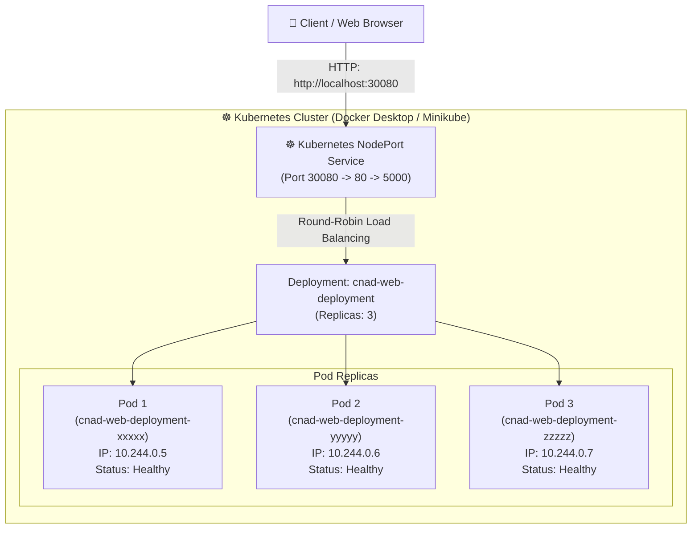

# Cloud-Native Application Development (CNAD) — Activity 01
## Containerization and Kubernetes Deployment of a Web Microservice


---

## 📌 Executive Summary

This repository contains the complete implementation for **CNAD Activity 01**. It demonstrates the end-to-end cloud-native lifecycle of a web microservice:
1. **Application Development:** An asynchronous, cloud-ready REST and web dashboard application built with **Python (FastAPI)**.
2. **Containerization:** A security-hardened, production-ready **Dockerfile** with non-root user privileges, layer caching, and native health checks.
3. **Container Execution:** Building a custom Docker image and verifying isolated execution within a standalone Docker container.
4. **Kubernetes Orchestration:** Declarative deployment with `deployment.yaml` (3 replicas, rolling updates, liveness/readiness probes, Downward API, resource limits) and service exposure with `service.yaml` (NodePort service).
5. **Verification & Testing:** Demonstration of container health probes, service connectivity, and round-robin load balancing across active pods.

---

## 🏗️ System Architecture



---

## 📂 Project Directory Structure

```text
cnad_activity_01/
├── app/
│   ├── __init__.py              # Application package initializer
│   ├── main.py                  # FastAPI cloud-native application logic & REST endpoints
│   ├── static/
│   │   └── style.css            # Responsive dashboard styles (dark theme)
│   └── templates/
│       └── index.html           # Live container status & pod verification dashboard
├── k8s/
│   ├── deployment.yaml          # Kubernetes Deployment (3 replicas, probes, resources)
│   ├── service.yaml             # Kubernetes NodePort Service definition
│   └── k8s-combined.yaml        # All-in-one Kubernetes manifest
├── scripts/
│   ├── build_and_run.ps1        # One-click Docker build, run, and verify script (PowerShell)
│   ├── deploy_k8s.ps1           # One-click Kubernetes deployment and status verification
│   ├── test_endpoints.ps1       # Automated HTTP verification & load-balancing tester
│   └── cleanup.ps1              # Graceful teardown script
├── tests/
│   └── test_main.py             # Pytest automated test suite
├── .dockerignore                # Build context exclusion rules
├── .gitignore                  # Git repository exclusion rules
├── Dockerfile                   # Secure, production-ready Docker container specification
├── requirements.txt             # Pinned Python dependencies
├── README.md                    # Project documentation & operational runbook
├── SUBMISSION_REPORT.md         # Comprehensive academic report with execution evidence
└── EVIDENCE_LOGS.md             # Recorded execution logs and terminal outputs
```

---

## 🌐 Application Endpoints

| Route | Method | Purpose | Response Format |
|---|---|---|---|
| `/` | `GET` | Web Dashboard displaying live Pod name, IP, uptime, and architecture | HTML |
| `/healthz` | `GET` | Kubernetes Liveness & Readiness probe endpoint | JSON (`HTTP 200`) |
| `/api/info` | `GET` | Complete application, container, and OS runtime metadata | JSON |
| `/api/metrics` | `GET` | Performance metrics (uptime seconds, request counters) | JSON |
| `/api/echo` | `GET` | Verification endpoint returning responding Pod hostname | JSON |
| `/docs` | `GET` | Interactive Swagger UI (OpenAPI specification) | HTML / Interactive |

---

## 🚀 Quickstart Guide

### 1. Prerequisites
Ensure the following tools are installed and operational:
- **Docker Desktop** (version 20+ with WSL 2 enabled) or Docker Engine
- **Kubernetes** enabled inside Docker Desktop (`Settings -> Kubernetes -> Enable Kubernetes`) OR **Minikube**
- **Git**
- **PowerShell** or Bash terminal

---

### 2. Local Testing (Optional)
Run the application locally without Docker to verify its behavior:
```powershell
# Navigate to project folder
cd cnad_activity_01

# Run tests
python -m pytest tests/ -v

# Start local server
python -m uvicorn app.main:app --host 0.0.0.0 --port 5000
```
Open [http://localhost:5000](http://localhost:5000) in your browser.

---

### 3. Step 1: Docker Containerization

#### A. Build the Custom Docker Image
Execute the build command to package the application with all dependencies:
```powershell
docker build -t cnad-web-app:v1.0.0 .
```

#### B. Verify Image in Local Docker Cache
```powershell
docker images cnad-web-app:v1.0.0
```

#### C. Run the Application inside a Docker Container
Run the container in detached mode, mapping host port `5000` to container port `5000`:
```powershell
docker run -d --name cnad-app-instance -p 5000:5000 cnad-web-app:v1.0.0
```

#### D. Verify Running Container & Health
```powershell
# Check running status
docker ps --filter "name=cnad-app-instance"

# Check container logs
docker logs cnad-app-instance

# Test the health endpoint
curl http://localhost:5000/healthz
```
*Tip: Or run the automated script:*
```powershell
.\scripts\build_and_run.ps1
```

---

### 4. Step 2: Kubernetes Deployment & Service Exposure

#### A. Apply Kubernetes Deployment and Service
Deploy 3 pod replicas and create the NodePort service:
```powershell
kubectl apply -f k8s/deployment.yaml
kubectl apply -f k8s/service.yaml
```
*(Or use the combined manifest: `kubectl apply -f k8s/k8s-combined.yaml`)*

#### B. Monitor Rollout Status
```powershell
kubectl rollout status deployment/cnad-web-deployment
```

#### C. Inspect Deployed Pods and Service
```powershell
# List pods with internal cluster IPs and assigned nodes
kubectl get pods -l app=cnad-web-app -o wide

# List service and exposed nodePort (30080)
kubectl get svc cnad-web-service
```

#### D. Access the Application via Kubernetes Service
- **Docker Desktop Users:** Open [http://localhost:30080](http://localhost:30080)
- **Minikube Users:** Run `minikube service cnad-web-service` to obtain the external URL.
- **Port-Forwarding Alternative:**
  ```powershell
  kubectl port-forward svc/cnad-web-service 5000:80
  ```
  Then access [http://localhost:5000](http://localhost:5000).

---

### 5. Step 3: Verification & Load-Balancing Demonstration

Run the automated endpoint and round-robin verification script:
```powershell
.\scripts\test_endpoints.ps1
```
Sample output demonstrating traffic distributed across different pods:
```text
Request #1 -> Handled by Pod: cnad-web-deployment-7b98d975c-48g9z
Request #2 -> Handled by Pod: cnad-web-deployment-7b98d975c-k2mws
Request #3 -> Handled by Pod: cnad-web-deployment-7b98d975c-r9pxl
Request #4 -> Handled by Pod: cnad-web-deployment-7b98d975c-48g9z
```

---

### 6. Clean-Up & Teardown

To release all resources after capturing demonstration evidence:
```powershell
.\scripts\cleanup.ps1
```
Or manually:
```powershell
kubectl delete -f k8s/k8s-combined.yaml
docker stop cnad-app-instance
docker rm cnad-app-instance
```

---

## 🔒 Security Best Practices Implemented

1. **Non-Root User:** The Dockerfile creates an unprivileged user (`appuser`, UID 10001) and sets `USER appuser`. This prevents container breakout attacks from inheriting host root privileges.
2. **Layer Caching:** `requirements.txt` is copied and installed prior to copying the application source code, avoiding unnecessary re-installation of dependencies.
3. **Minimal Base Image:** Uses `python:3.10-slim`, reducing image size by ~80% compared to standard Python images and minimizing vulnerabilities.
4. **Health Checks:** Native HTTP health probes configured in both Docker (`HEALTHCHECK`) and Kubernetes (`livenessProbe` and `readinessProbe`).
5. **Resource Limits:** Configured strict CPU and memory `requests` and `limits` in Kubernetes to prevent "noisy neighbor" resource starvation.

---

## 📄 Submission Package

For grading and assessment, refer to the following documents in this repository:
- **`SUBMISSION_REPORT.md`**: Complete theoretical and empirical submission report with conceptual explanations, architecture details, and screenshot placeholders.
- **`EVIDENCE_LOGS.md`**: Raw command-line transcripts and outputs for verification.
