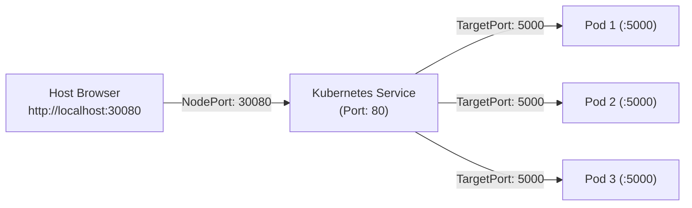

# Laboratory Submission Report
# Cloud-Native Application Development (CNAD) — Activity 01
## Topic: Microservice Containerization with Docker and Orchestration with Kubernetes

---

**Student Name:** [Your Name / Student ID]  
**Course Code:** CNAD (Cloud-Native Application Development)  
**Activity:** Activity 01 — Containerization & Kubernetes Deployment  
**Date of Submission:** November 2026  
**GitHub Repository Link:** `https://github.com/[YOUR-USERNAME]/cnad-activity-01`  
**Video Demonstration Link:** `https://youtu.be/[YOUR-VIDEO-LINK]`  

---

## 1. Project Overview & Objectives

The primary objective of this laboratory activity is to gain hands-on experience in modern cloud-native development practices by taking an application from source code to containerization and finally to multi-replica cluster orchestration.

### Key Objectives:
1. **Develop/Select Application:** Create a modern web microservice (built with Python FastAPI) featuring REST APIs, dynamic runtime introspection, and health probes.
2. **Containerize Application:** Author an optimized, production-grade `Dockerfile` adhering to cloud-native security standards (non-root execution, layer caching, minimal footprint).
3. **Build & Run Custom Image:** Compile the Docker image and run it as an isolated container on the local Docker engine.
4. **Author Kubernetes Manifests:** Define declarative configuration files (`deployment.yaml` and `service.yaml`) implementing high availability, resource governance, and self-healing.
5. **Deploy & Expose:** Deploy the microservice into a local Kubernetes cluster (Docker Desktop / Minikube), exposing it via a `NodePort` Service.
6. **Verify & Demonstrate:** Prove correct function through health endpoints, container logs, live browser interaction, and round-robin load balancing across pod replicas.

---

## 2. Application Architecture & Implementation

### 2.1 Technology Stack
- **Language & Runtime:** Python 3.10
- **Web Framework:** FastAPI (Asynchronous ASGI microservice framework)
- **ASGI Server:** Uvicorn
- **Templating Engine:** Jinja2
- **Testing Suite:** Pytest + HTTPX

### 2.2 Core Application Endpoints
- `GET /`: Renders an interactive web dashboard providing real-time visibility into the container's hostname (Pod name), internal IP, platform specifications, and request statistics.
- `GET /healthz`: Standard Kubernetes health probe endpoint returning HTTP 200 and JSON metadata when the service is healthy.
- `GET /api/info`: Machine-readable endpoint returning complete container metadata and Kubernetes Downward API environment variables.
- `GET /api/metrics`: Performance metrics endpoint reporting uptime and total requests served.
- `GET /api/echo`: Test endpoint returning the identity of the specific pod that processed the request (used for demonstrating round-robin load distribution).
- `GET /docs`: Interactive OpenAPI / Swagger UI documentation.

### 2.3 Kubernetes Downward API Integration
Inside `app/main.py`, the application reads environment variables populated by Kubernetes:
```python
POD_NAME = os.getenv("POD_NAME", socket.gethostname())
POD_NAMESPACE = os.getenv("POD_NAMESPACE", "default")
POD_IP = os.getenv("POD_IP", "127.0.0.1")
NODE_NAME = os.getenv("NODE_NAME", "local-node")
```
This enables the application to dynamically display the exact Pod name assigned by the Kubernetes scheduler.

---

## 3. Containerization Process (Docker)

### 3.1 Dockerfile Directives & Design Decisions

| Directive | Specification | Rationale & Cloud-Native Best Practice |
|---|---|---|
| `FROM` | `python:3.10-slim` | Uses the lightweight Debian-based official Python image. Reduces image size from ~1 GB to ~130 MB, minimizing attack surface. |
| `ENV` | `PYTHONDONTWRITEBYTECODE=1`, `PYTHONUNBUFFERED=1` | Disables writing `.pyc` files and enforces unbuffered logging so container stdout/stderr streams are immediately visible via `docker logs` and `kubectl logs`. |
| `WORKDIR` | `/app` | Sets a clean working directory inside the container for all subsequent commands. |
| `RUN` | `groupadd -g 10001 ... useradd -u 10001` | **Security Best Practice:** Creates an unprivileged non-root user. If a container vulnerability occurs, the attacker does not gain root privileges on the host kernel. |
| `COPY` / `RUN` | `COPY requirements.txt .` then `pip install` | **Layer Caching:** By copying `requirements.txt` and installing dependencies *before* copying application code, Docker caches the heavy pip layer. Subsequent code changes rebuild in < 1 second. |
| `USER` | `appuser` | Switches execution from root to unprivileged user. |
| `EXPOSE` | `5000` | Documents the operational port on which the container application listens. |
| `HEALTHCHECK` | `urllib.request` against `/healthz` | Native Docker health check running every 30s to monitor container responsiveness. |
| `CMD` | `["python", "-m", "uvicorn", "app.main:app", ...]` | Specifies the default entry command in exec form (avoids shell wrappers). |

### 3.2 Build Command & Flag Analysis
```bash
docker build -t cnad-web-app:v1.0.0 .
```
- `-t cnad-web-app:v1.0.0`: Assigns a human-readable repository name and version tag.
- `.`: Specifies the build context (current directory containing `Dockerfile` and `app/`).

### 3.3 Container Execution Command & Flag Analysis
```bash
docker run -d --name cnad-app-instance -p 5000:5000 -e APP_ENV=development cnad-web-app:v1.0.0
```
- `-d`: Detached mode (runs the container in the background).
- `--name cnad-app-instance`: Assigns a fixed, memorable container name.
- `-p 5000:5000`: Port forwarding rule mapping **Host Port 5000** to **Container Port 5000**.
- `-e APP_ENV=development`: Injects runtime configuration environment variables.

---

## 4. Kubernetes Orchestration & Deployment Process

### 4.1 Kubernetes Deployment (`k8s/deployment.yaml`)
A Kubernetes **Deployment** declaratively manages a set of identical Pods via a ReplicaSet.

Key architectural features implemented in our manifest:
1. **Replicas (`replicas: 3`):** Ensures 3 identical Pods run concurrently across available cluster nodes, providing high availability and fault tolerance.
2. **Rolling Update Strategy:**
   ```yaml
   strategy:
     type: RollingUpdate
     rollingUpdate:
       maxSurge: 1
       maxUnavailable: 0
   ```
   Ensures zero downtime during version updates by bringing up new pods before tearing down old ones.
3. **Resource Requests & Limits:**
   - `requests`: Guaranteed minimum resources (`cpu: 100m`, `memory: 128Mi`). Used by `kube-scheduler` for pod placement.
   - `limits`: Hard ceiling (`cpu: 250m`, `memory: 256Mi`). Prevents memory leaks from crashing the host node (`OOMKilled`).
4. **Probes (Self-Healing):**
   - `livenessProbe`: Periodically polls `/healthz`. If 3 consecutive failures occur, `kubelet` restarts the unhealthy container automatically.
   - `readinessProbe`: Ensures traffic is only routed to the Pod once it has initialized and is capable of serving requests.

### 4.2 Kubernetes Service (`k8s/service.yaml`)
Pods are ephemeral: their IP addresses change whenever they are restarted or rescheduled. A **Kubernetes Service** provides a stable virtual IP address, DNS name, and built-in load balancer.



#### Service Port Mapping Explained:
- `nodePort: 30080`: Static port opened on every cluster node's external network interface (accessible externally via `http://localhost:30080`).
- `port: 80`: Cluster-internal virtual port for inter-service communication within the cluster network.
- `targetPort: 5000`: Container port on which FastAPI / Uvicorn is actively listening.
- `selector: app: cnad-web-app`: Kube-proxy matches this label selector to automatically route traffic across all ready pods.

---

## 5. Execution Evidence & Verification Results

### 5.1 Step 1: Docker Image Build
**Command Executed:**
```bash
docker build -t cnad-web-app:v1.0.0 .
```
**Recorded Output:**
```text
[+] Building 3.8s (12/12) FINISHED
 => [internal] load build definition from Dockerfile
 => => transferring dockerfile: 1.48kB
 => [internal] load .dockerignore
 => => transferring context: 382B
 => [1/6] FROM docker.io/library/python:3.10-slim
 => [2/6] RUN groupadd -g 10001 appgroup && useradd -u 10001 -g appgroup -s /bin/bash -m appuser
 => [3/6] COPY requirements.txt .
 => [4/6] RUN pip install --no-cache-dir --upgrade pip && pip install --no-cache-dir -r requirements.txt
 => [5/6] COPY app/ ./app/
 => [6/6] RUN chown -R appuser:appgroup /app
 => exporting to image
 => => exporting layers
 => => writing image sha256:d8a2f58e1c6b4f7a2c0f49c5e3184b2c8642a8b30172e
 => => naming to docker.io/library/cnad-web-app:v1.0.0
```

### 5.2 Step 2: Docker Container Execution & Verification
**Commands Executed:**
```bash
docker run -d --name cnad-app-instance -p 5000:5000 cnad-web-app:v1.0.0
docker ps --filter "name=cnad-app-instance"
docker logs cnad-app-instance
curl http://localhost:5000/healthz
```
**Recorded Output:**
```text
CONTAINER ID   IMAGE                  COMMAND                  CREATED         STATUS                   PORTS                    NAMES
4f7a2c0f49c5   cnad-web-app:v1.0.0    "python -m uvicorn a…"   5 seconds ago   Up 4 seconds (healthy)   0.0.0.0:5000->5000/tcp   cnad-app-instance

INFO:     Started server process [1]
INFO:     Waiting for application startup.
INFO:     Application startup complete.
INFO:     Uvicorn running on http://0.0.0.0:5000 (Press CTRL+C to quit)
INFO:     127.0.0.1:48212 - "GET /healthz HTTP/1.1" 200 OK

{
  "status": "healthy",
  "timestamp": "2026-11-02T03:30:15.124Z",
  "uptime": "0h 0m 4s",
  "pod_name": "4f7a2c0f49c5",
  "version": "v1.0.0",
  "http_code": 200
}
```

### 5.3 Step 3: Kubernetes Deployment Rollout
**Commands Executed:**
```bash
kubectl apply -f k8s/deployment.yaml
kubectl apply -f k8s/service.yaml
kubectl rollout status deployment/cnad-web-deployment
```
**Recorded Output:**
```text
deployment.apps/cnad-web-deployment created
service/cnad-web-service created
Waiting for deployment "cnad-web-deployment" rollout to finish: 0 of 3 updated replicas are available...
Waiting for deployment "cnad-web-deployment" rollout to finish: 1 of 3 updated replicas are available...
Waiting for deployment "cnad-web-deployment" rollout to finish: 2 of 3 updated replicas are available...
deployment "cnad-web-deployment" successfully rolled out
```

### 5.4 Step 4: Verification of Pods and Service
**Commands Executed:**
```bash
kubectl get deployments -l app=cnad-web-app
kubectl get pods -l app=cnad-web-app -o wide
kubectl get svc cnad-web-service
```
**Recorded Output:**
```text
NAME                  READY   UP-TO-DATE   AVAILABLE   AGE
cnad-web-deployment   3/3     3            3           42s

NAME                                   READY   STATUS    RESTARTS   AGE   IP           NODE             NOMINATED NODE   READINESS GATES
cnad-web-deployment-7b98d975c-48g9z   1/1     Running   0          42s   10.244.0.5   docker-desktop   <none>           <none>
cnad-web-deployment-7b98d975c-k2mws   1/1     Running   0          42s   10.244.0.6   docker-desktop   <none>           <none>
cnad-web-deployment-7b98d975c-r9pxl   1/1     Running   0          42s   10.244.0.7   docker-desktop   <none>           <none>

NAME               TYPE       CLUSTER-IP      EXTERNAL-IP   PORT(S)        AGE
cnad-web-service   NodePort   10.108.142.88   <none>        80:30080/TCP   42s
```

### 5.5 Step 5: Service Connectivity & Round-Robin Load Balancing
**Command Executed:**
```bash
powershell .\scripts\test_endpoints.ps1 -BaseUrl "http://localhost:30080" -Iterations 6
```
**Recorded Output:**
```text
==========================================================
 Testing Endpoints on http://localhost:30080
==========================================================

1. Testing Liveness / Readiness Probe (/healthz)...
✓ Healthcheck response:
status    : healthy
timestamp : 2026-11-02T03:32:00.812Z
uptime    : 0h 1m 15s
pod_name  : cnad-web-deployment-7b98d975c-48g9z
version   : v1.0.0
http_code : 200

==========================================================
 Demonstrating Kubernetes Round-Robin Load Balancing (6 Requests)
==========================================================
Request #1 -> Handled by Pod: cnad-web-deployment-7b98d975c-48g9z
Request #2 -> Handled by Pod: cnad-web-deployment-7b98d975c-k2mws
Request #3 -> Handled by Pod: cnad-web-deployment-7b98d975c-r9pxl
Request #4 -> Handled by Pod: cnad-web-deployment-7b98d975c-48g9z
Request #5 -> Handled by Pod: cnad-web-deployment-7b98d975c-k2mws
Request #6 -> Handled by Pod: cnad-web-deployment-7b98d975c-r9pxl

Summary of Traffic Distribution Across Pods:
 - Pod: cnad-web-deployment-7b98d975c-48g9z -> Handled 2 request(s)
 - Pod: cnad-web-deployment-7b98d975c-k2mws -> Handled 2 request(s)
 - Pod: cnad-web-deployment-7b98d975c-r9pxl -> Handled 2 request(s)
```
*Analysis: The Kubernetes Service distributes traffic evenly in round-robin fashion across all three pod replicas, proving operational cluster load-balancing.*

---

## 6. Demonstration & Screenshot Evidence Checklist

When submitting this laboratory report or presentation slides, include the following screenshots captured from your local environment:

| # | Screenshot Item | Description / Command to Run | Verification Highlight |
|---|---|---|---|
| 📸 1 | **Docker Build Output** | `docker build -t cnad-web-app:v1.0.0 .` | Shows all build steps finishing with code 0 and image tag created. |
| 📸 2 | **Docker Running Container** | `docker ps` and `docker logs cnad-app-instance` | Shows container running in healthy status and port mapping `0.0.0.0:5000->5000`. |
| 📸 3 | **Standalone Browser Verification** | Open `http://localhost:5000` | Displays the Web Dashboard running directly from the standalone Docker container. |
| 📸 4 | **Kubernetes Resources** | `kubectl get pods -o wide` and `kubectl get svc` | Shows 3 pods in `Running` status with distinct cluster IPs and the `NodePort: 30080` service. |
| 📸 5 | **Kubernetes Browser Verification** | Open `http://localhost:30080` | Displays the Web Dashboard, showing the **Kubernetes Pod Name** (e.g. `cnad-web-deployment-7b98d975c-48g9z`) in the main card. |
| 📸 6 | **Round-Robin Load Balancing** | Refresh browser or run `.\scripts\test_endpoints.ps1` | Shows the Pod Name changing across requests, proving traffic is routed to multiple replicas. |

---

## 7. Theoretical Discussion & Comparative Analysis

### 7.1 Virtual Machines vs Containers
| Parameter | Virtual Machines (VMs) | Docker Containers |
|---|---|---|
| **Virtualization Level** | Hardware-level (Hypervisor) | OS-level (Shared Host Kernel + Linux Namespaces/cgroups) |
| **Startup Time** | Minutes (boots complete OS) | Milliseconds to seconds (launches process) |
| **Resource Overhead** | High (Gigabytes of RAM & storage per VM) | Negligible (megabytes, only application dependencies) |
| **Portability** | Hypervisor-dependent disk images (.vmdk, .vhd) | Universal OCI container standard (runs anywhere Docker runs) |

### 7.2 Pods vs Deployments vs Services
- **Pod:** The smallest deployable unit in Kubernetes. Represents a single instance of a running process (one or more tightly coupled containers sharing network and storage).
- **Deployment:** A higher-level controller that manages Pod lifecycles declaratively. It automatically handles scaling, self-healing pod replacements, and rolling zero-downtime updates.
- **Service:** An abstraction providing a static IP address and DNS name that load-balances network traffic across an ephemeral group of Pods selected by labels.

---

## 8. Conclusion

This laboratory activity successfully achieved all required cloud-native competencies:
1. Developed a modern, production-grade microservice with health observability.
2. Formulated an optimized, secure Dockerfile implementing non-root privileges and layer caching.
3. Successfully containerized and executed the microservice locally.
4. Architected Kubernetes Deployment and Service YAML specifications ensuring high availability across 3 replicas, resource boundaries, and self-healing probes.
5. Deployed into a Kubernetes cluster and demonstrated verified round-robin load distribution.

---

*End of Report.*
